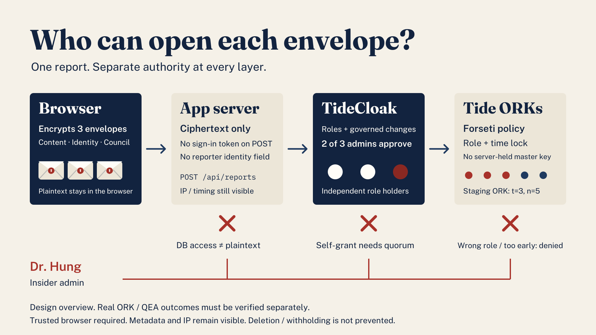

<picture>
  <source media="(prefers-color-scheme: dark)" srcset="public/brand/logo-wordmark-light.svg">
  
</picture>

[](https://tide.org/tidecloak?utm_source=github&utm_medium=readme&utm_campaign=unlocked)

## Project overview

**SealedVoice is a prototype for verified-name reporting that keeps identity sealed from the accused administrator.**

Built with [TideCloak](https://tide.org/tidecloak?utm_source=github&utm_medium=readme&utm_campaign=unlocked).

### 1. Vision & originality
Students should be able to report misconduct even when the accused controls the institution's IT. SealedVoice separates a verified identity from an investigation. Unlike CoverDrop's concealed contact or Callisto's matching escrow, our focus is verified-but-sealed reporting inside a university. See [related work](docs/SOTA.md).

### 2. Trust constraint insight
Vietnam's [Law on Denunciation (2018)](https://noichinh.vn/hoi-dap-phap-luat/202001/tiep-nhan-xu-ly-ban-dau-thong-tin-to-cao-va-viec-tiep-nhan-xu-ly-thong-tin-co-noi-dung-to-cao-307456/) requires the reporter's name and address. Anonymous reports are generally not processed as denunciations, though concrete evidence can prompt inspection. At a university, the accused may also control the reporting system: the student must trust the very administrator she accuses.

### 3. Value & impact
Mai receives a pseudonymous receipt. Inspector Lan reads the allegation without the identity. Guardian Minh verifies the student separately. A timed council copy provides an escalation path, provided the ciphertext remains available.

### 4. Why TideCloak matters
Forseti policies on Tide's ORK network decide decryption, not our server. Role changes go through TideCloak QEA approval requests, so an application admin cannot silently self-grant.

Live-verified (22 Oct): TideCloak login for 4 personas; Tide-issued roles; 3 Forseti policies committed via the Tide enclave; a report sealed in Mai's browser through 5 Tide ORKs, stored as ciphertext; Inspector Lan decrypted its content; QEA left role requests pending. Not yet verified live: council time lock, 2-of-3 quorum (one admin today).



### 5. Prototype & storytelling
The demo follows Mai, Lan, Minh and insider Dr. Hung through submission, investigation, identity denial, a pending self-grant and council escalation. **The video uses mock-mode capture: encryption, roles, quorum and time locks are simulated.** See [validation status](docs/VALIDATION.md) for the live boundary.

## Demo video

**[▶ Watch the 2-minute demo (Video.mp4)](Video.mp4)** · 1:48 · English narration · mock-mode walkthrough plus live Tide evidence.

| Resource | Link |
|---|---|
| Architecture | [docs/architecture.png](docs/architecture.png) |
| Live validation status | [docs/VALIDATION.md](docs/VALIDATION.md) |
| Live setup guide | [docs/SETUP-LIVE.md](docs/SETUP-LIVE.md) |
| Trust model · attack vectors | [TRUST-MODEL](docs/TRUST-MODEL.md) · [ATTACK-VECTORS](docs/ATTACK-VECTORS.md) |
| Shot list · title cards · credits | [DEMO_SCRIPT](docs/DEMO_SCRIPT.md) · [docs/video](docs/video) · [CREDITS](docs/CREDITS.md) |

## Setup

Use Node.js **22.18+** (or Node 24+) and npm. Run commands from the repository root. The following path is the mock walkthrough; no Docker, Tide account, `.env` file or private configuration is needed.

```bash
git clone https://github.com/Towfienes/SealedVoice
cd SealedVoice
npm install
npm test
npm run build
NEXT_PUBLIC_VAULT=mock npm run dev
```

Open <http://localhost:3000>. Mock mode needs no Tide account and uses synthetic data in this browser's localStorage, including plaintext under `sv-mock-plain`. Use the **Signed in as** selector to choose Mai, file a report, then switch personas on the investigator, guardian, insider and council pages. Use it only for development; see [validation status](docs/VALIDATION.md) for the revision tested.

### Browser acceptance tests

```bash
npx playwright install chromium
npm run test:e2e
```

The test server runs with `NEXT_PUBLIC_VAULT=mock` on port 3000; stop another dev server first. Tests cover US1–US5 through both the browser vault and actual form/persona interactions. If Google Chrome is installed, use `PLAYWRIGHT_CHANNEL=chrome npm run test:e2e` to use it instead of managed Chromium. Mock results are not evidence of real encryption, anonymous HTTP submission, QEA or ORK enforcement.

### Live TideCloak setup

This path requires Docker with its daemon running, Bash, curl, jq and a Tide subscription email. Review the scripts before running them; local development credentials come from the existing init configuration. Never use those defaults on a public deployment.

1. Run `npm run init` to start the staging TideCloak container and provision the realm. Enter your own subscription email, personally review and accept the displayed Tide terms, then complete Dr. Hung's enrollment. This script uses `sudo docker`; see the detailed guide below for an existing container.
2. Run `bash scripts/setup-personas.sh submit`. In the realm's Tide console, approve and commit role requests first, then user requests. Run `bash scripts/setup-personas.sh map`, approve and commit those mappings, then `bash scripts/setup-personas.sh invite`. Invitation links go to ignored `data/invite-links.txt`.
3. Enroll each persona in a separate browser profile. The Linux helper is `bash scripts/open-persona.sh <persona> invite`; on macOS, open the saved invitation link manually. Follow the four-account mapping below; do not enroll extra accounts.
4. Start `NEXT_PUBLIC_VAULT=tide npm run dev` on **port 3000**. As Dr. Hung, open `/admin/policies` and create, approve and commit the investigator, guardian and council policies **before adding admins #2 and #3**.
5. Run `bash scripts/setup-personas.sh admins`, approve and commit those changes in the Tide console, then sign out/in on affected accounts. Have the lead verify three distinct admins and the two-admin threshold. Refresh config with `EXPORT_ONLY=1 bash init/tcinit.sh`; keep both generated data files private.
6. Run the live checks in [TRUST-MODEL.md](docs/TRUST-MODEL.md). For a production build, set `NEXT_PUBLIC_VAULT=tide` at build time too; switching modes requires restarting/rebuilding. On 22 Oct a report was sealed live through 5 Tide ORKs and its content decrypted by the investigator.

See [the detailed live setup and four-account mapping](docs/SETUP-LIVE.md). The lead confirmed login, roles, three enclave-committed policies, pending QEA requests, a live seal through 5 Tide ORKs and the investigator's content decrypt; council timing and 2-of-3 quorum remain unverified live. Live setup was not reproduced in the fresh-clone check; see [validation status](docs/VALIDATION.md).

## Limits
- Writing style, evidence or contextual details can identify a reporter.
- Tide restricts reading; it does not prevent deletion, withholding or rollback. Keep the receipt; it is not an external backup or an automatic delivery service.
- Metadata, IP addresses and timing remain visible. Omitting an Authorization header is not network anonymity.
- The demo targets the **staging ORK network, t=3, n=5**; this is not a production deployment.
- The browser is the trust boundary. A compromised browser, extension or server-delivered JavaScript can capture plaintext before sealing or after opening.
- Mock mode stores plaintext locally and its digest is a placeholder, not a cryptographic integrity proof. Do not enter real reports.
- Bearer-token replay and DPoP proof replay need separate controls; see [attack vectors](docs/ATTACK-VECTORS.md). Live: Tide-issued roles, pending QEA requests, browser sealing through Tide ORKs and investigator decryption of content. Not verified end to end: identity denial for every non-guardian role, council timing and completed 2-of-3 quorum approval.
- A one-admin realm can approve its own pending requests; 2-of-3 requires three distinct admins and committed grants. A guardian can disclose identities they legitimately open; colluding administrators and unavailable ORKs remain threats.

## Credits
**Team Fprinciples** (RMIT SGS) · RMIT GenAI & Cybersecurity Hackathon 2026, Challenge 2 "Tide UNLOCKED".

Built on [tide-foundation/forseti-crypto-quickstart](https://github.com/tide-foundation/forseti-crypto-quickstart).
Token-verifier tests and the original trust/attack analyses were adapted from the team's SealedBid work. [TideCloak](https://tide.org/tidecloak) provides the intended identity, policy and threshold-cryptography infrastructure. All demo personas and reports are synthetic.
Original SVG artwork, outlined font sources and retained licence notices are listed in [visual credits](docs/CREDITS.md).
